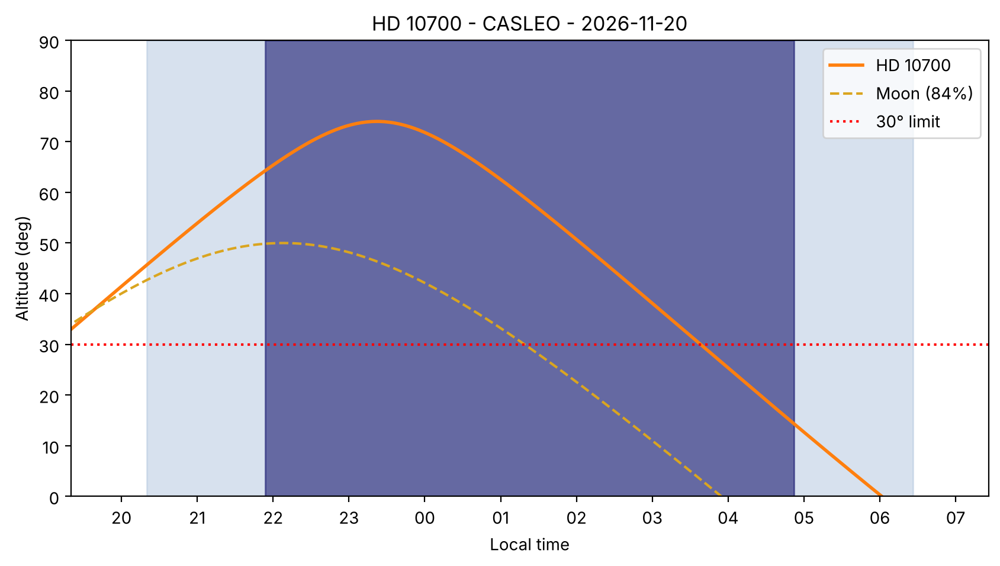

# Observability planner

A Jupyter notebook to check if an astronomical target is observable on a given night from
a given observatory.

Given an object name (searched in SIMBAD) or its coordinates, a date and an observatory,
it calculates:

- sunset and sunrise
- the altitude of the target during the night, when it can be observed and the best time
- the Moon phase, moonrise and moonset, and the distance between the Moon and the target
- a plot of the altitude of the target and the Moon along the night



## How to use it

```bash
pip install -r requirements.txt
jupyter lab observability_planner.ipynb
```

Change the input cell and run all the cells:

```python
TARGET = "HD 10700"
RA = None        # or coordinates, e.g. "01:44:04.1"
DEC = None       # e.g. "-15:56:15"

DATE = "2026-11-20"
SITE = "CASLEO"
MIN_ALT = 30
```

Two observatories from San Juan, Argentina are included (CASLEO and OAFA). Other
observatories can be added to the `observatories` dictionary.

## Requirements

Python 3.9 or newer, `astropy`, `astroquery`, `numpy` and `matplotlib`.
